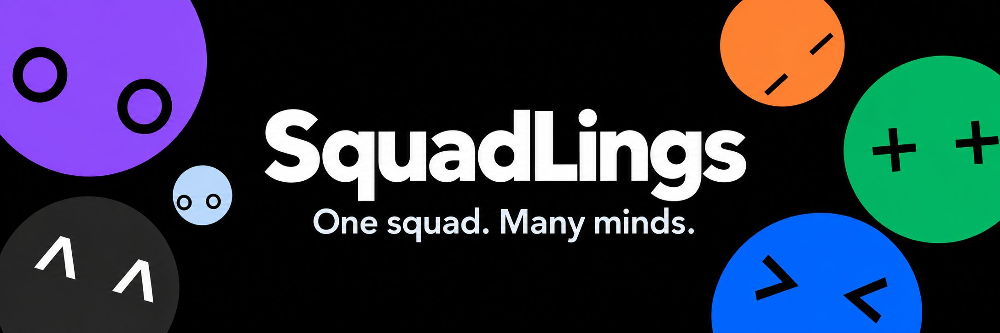
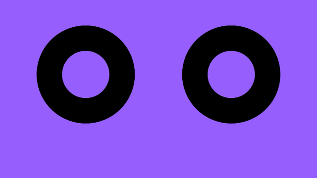
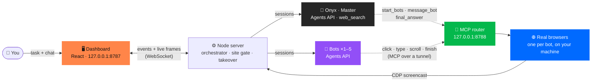

<a href="#readme">
  
</a>

<h3 align="center">A swarm of AI agents that take the wheel of your computer and get the job done.</h3>

<p align="center">
  
  
  
  
  
  
</p>

<p align="center">
  <a href="#-quick-look"><b>Quick Look</b></a> ·
  <a href="#-use-cases"><b>Use cases</b></a> ·
  <a href="#-meet-the-squad"><b>The squad</b></a> ·
  <a href="#-how-it-works"><b>How it works</b></a> ·
  <a href="#-quick-start"><b>Quick start</b></a> ·
  <a href="#-safety"><b>Safety</b></a> ·
  <a href="master.md"><b>Full spec</b></a> ·
  <a href="SUBMISSION.md"><b>Submission</b></a>
</p>

<br>

## 👀 Quick Look

<p align="center">
  <a href="docs/video/squadlings-intro.mp4">
    
  </a>
  <br>
  <sub><b><a href="docs/video/squadlings-intro.mp4">▶ Play the full 52-second film (MP4, with sound)</a></b> · <a href="docs/video/storyboard.md">storyboard</a></sub>
</p>

<br>

## 🐝 A swarm that drives your computer

SquadLings is a **swarm of computer-use agents**. Hand it a task and up to **five AI agents take the wheel at once**: opening sites, clicking, typing, scrolling, filling forms and reading pages, each in its own browser window on your machine.

**Onyx**, the head of the swarm, breaks the task apart, sends each agent off with its own job, keeps them on track while they work, and hands you back **one clean answer with sources**. You watch every agent live, chat with Onyx mid-run, and grab the controls yourself whenever you want.

<p align="center"><b>You type one line. Five agents do the clicking.</b></p>

<table>
  <tr>
    <td width="33%" valign="top">
      <h3>👀 Visible</h3>
      No black box. Every bot's browser streams live to the dashboard, and the bot's own cursor glides to each element before it clicks, with a caption saying why.
    </td>
    <td width="33%" valign="top">
      <h3>⚡ Parallel</h3>
      Five agents work at once, sharing findings as they go. A task that would take an hour of tab-juggling finishes in about a minute.
    </td>
    <td width="33%" valign="top">
      <h3>🛡️ Safe by design</h3>
      Site allow-lists, approvals and human takeover are enforced in the browser layer, where the model can't override them.
    </td>
  </tr>
</table>

<br>

## 🎯 Use cases

Anything you'd do yourself across a pile of browser tabs, the swarm can split up and do in parallel. Every card below is just a task you type: no templates, no setup.

<table>
  <tr>
    <td width="33%" valign="top">
      <h3> Trip planning</h3>
      Stays, food, things to do and getting around, researched side by side and merged into one itinerary.
      <br><br><sub><i>"Plan a weekend in Kochi for our team of four."</i></sub>
    </td>
    <td width="33%" valign="top">
      <h3> Price hunting</h3>
      One agent per store, comparing price, delivery, returns and coupons, so you see the real best deal.
      <br><br><sub><i>"Find the cheapest noise-cancelling headphones under ₹25,000 across four stores."</i></sub>
    </td>
    <td width="33%" valign="top">
      <h3> Live research</h3>
      Several primary sources checked at the same moment, with conflicts flagged and every claim linked.
      <br><br><sub><i>"Tomorrow's forecast for Tokyo, London, New York and Sydney, from each national weather service."</i></sub>
    </td>
  </tr>
  <tr>
    <td width="33%" valign="top">
      <h3> Competitor research</h3>
      One agent per competitor: pricing pages, feature lists and sign-up flows, laid out side by side.
      <br><br><sub><i>"Compare the pricing and free tiers of five note-taking apps."</i></sub>
    </td>
    <td width="33%" valign="top">
      <h3> QA testing</h3>
      A first-timer, a keyboard-only user, a mobile user and a breaker, all clicking through your web app at once and reporting what broke.
      <br><br><sub><i>"Try to sign up and check out on staging.example.com, and report every bug you hit."</i></sub>
    </td>
    <td width="33%" valign="top">
      <h3> Portals with no API</h3>
      Vendor quotes, admin panels and dashboards that only have a web UI: one agent per portal, one summary for you.
      <br><br><sub><i>"Get delivery quotes for 20 kg from Kochi to Bengaluru on three courier sites."</i></sub>
    </td>
  </tr>
</table>

<br>

## ⚔️ One agent vs. the swarm

| | A single browsing agent | **SquadLings** |
| --- | --- | --- |
| **Speed** | One tab at a time | Up to **5 browsers in parallel** |
| **What you see** | A screenshot now and then | **Live video** of every browser, with the agent's cursor |
| **Hits a CAPTCHA** | The run stalls | **You take over** in the tile, then hand it back |
| **Change of plan** | Wait until it's done | **Chat with Onyx mid-run**; it re-tasks the team |
| **The answer** | Whatever one agent found | **Merged from every agent**, cross-checked, with sources |

<br>

## 🫧 Meet the squad

The cast comes from the OpenAI DevDay community hackathon sticker sheet, in the DevDay event colours.

<table align="center">
  <tr>
    <td align="center" width="16%"><br><b>Onyx</b><br><sub>The calm conductor</sub></td>
    <td align="center" width="16%"><br><b>Plum</b><br><sub>The skeptic</sub></td>
    <td align="center" width="16%"><br><b>Lime</b><br><sub>The finder</sub></td>
    <td align="center" width="16%"><br><b>Tango</b><br><sub>The patient one</sub></td>
    <td align="center" width="16%"><br><b>Blu</b><br><sub>The doer</sub></td>
    <td align="center" width="16%"><br><b>Sky</b><br><sub>The cheerful one</sub></td>
  </tr>
  <tr>
    <td align="center"><sub><i>"One thing at a time. All together."</i></sub></td>
    <td align="center"><sub><i>"Trust, but double-check."</i></sub></td>
    <td align="center"><sub><i>"There's always a little more to discover."</i></sub></td>
    <td align="center"><sub><i>"Good things take a little time."</i></sub></td>
    <td align="center"><sub><i>"Less talking. More doing."</i></sub></td>
    <td align="center"><sub><i>"A little optimism goes a long way."</i></sub></td>
  </tr>
</table>

Onyx plans, steers and merges; it never browses. The five bots do the browsing. Each character's face reacts as it reads, scrolls, types, finds something, gets stuck or finishes.

<br>

## 🧠 How it works



1. **You give a goal** in the home bar and pick how many agents (1–5) and how hard they should think (None → X-High).
2. **Onyx does the groundwork.** It researches with `web_search`, then calls `start_bots` with self-contained goals, start URLs and allowed sites.
3. **Bots browse for real.** Each bot is its own Agents API session. It sees a page as a numbered list of elements (`[12] button "Search"`) and acts through our MCP tools. The clicks happen in real browsers, on your machine.
4. **The team talks.** Bots report to Onyx and message each other, and new messages ride along with each bot's next tool result. Onyx can steer, stop or re-task any bot, and you can type follow-ups at any time.
5. **Humans stay in charge.** A bot that reaches a CAPTCHA or human check pauses and asks. You click **Take over**, solve it in the live tile, and hand it back.
6. **Onyx merges** everything into one answer with sources, and the chat is saved so you can reopen it later.

<br>

## 📈 From real runs

<table>
  <tr>
    <td align="center"><h2>38 s</h2><sub>3 bots: HN top story,<br>newest Lobsters post,<br>latest Node.js release</sub></td>
    <td align="center"><h2>~5¢</h2><sub>cost of that run<br>(GPT-6.1 Sol Master,<br>GPT-6-Luna bots)</sub></td>
    <td align="center"><h2>4</h2><sub>national weather services<br>checked in parallel<br>(121 s, $0.13)</sub></td>
    <td align="center"><h2>13 / 13</h2><sub>tasks solved on our<br>TestTown agent eval</sub></td>
  </tr>
</table>

<sub>Measured on 10–11 October 2026 with a prewarmed tunnel. Full logs and the run-by-run story are in <a href="master.md">master.md</a> §12.6 and §19.8.</sub>

<br>

## 🚀 Quick start

**You need:** Node **22.18+**, [`cloudflared`](https://developers.cloudflare.com/cloudflare-one/connections/connect-networks/downloads/) (`brew install cloudflared`), and an OpenAI API key with Agents API access.

Run commands from the repository root, not the old `dashboard/` folder. Select the supported runtime with `nvm use` (`.nvmrc` selects Node 24; run `nvm install` once if needed). `npm run dev` starts the complete local dashboard and backend on port 8787. For frontend hot reload on port 5173, run `npm run web` in a second terminal while the backend stays running.


```sh
# 1 · install
npm install
npx playwright install chromium   # one-time download of the agents' browser
npm --prefix web install

# 2 · configure: put your OPENAI_API_KEY in .env
cp .env.example .env

# 3 · keep a tunnel warm (optional, saves ~20 s on the first run)
npm run prewarm          # leave running in its own terminal

# 4 · launch the dashboard
npm run dev              # builds web/ and opens http://127.0.0.1:8787 (alias for npm run ui)
```

Type a task, pick your squad, and press send.

**Local import verification (11 October 2026):** The downloaded export builds with Node 24.14.1: server typecheck and the React production build passed, as did 15 unit tests and five mock API scenarios. The default shell on the importing Mac uses Node 18; select Node 22.18+ first (for example, `nvm use 24`). Browser tests are blocked on this Mac: the bundled Playwright cannot install Chromium on macOS 12. Use an OS supported by that Playwright version for browser tests and agent runs. The import was subsequently committed and pushed as `89f3c14`.

**Local QA target:** `npm run buggymart` starts [BuggyMart](targets/buggymart/README.md) at **http://127.0.0.1:3001**: a small shop with 10 deliberately easy bugs for the agents to find. Give Onyx that URL and your testing task. Use **Reset demo** in the shop footer for a fresh run, or start with `-- --bugs none` to compare against working behavior. The shop needs no API key; agent runs use the normal dashboard configuration.

> [!TIP]
> **Try it for free first.** `node scripts/dev-mock-ui.ts --port 8796 --mcp-port 8795` runs the real server with a scripted mock Onyx and bots. Any task plays the same run, and nothing reaches OpenAI.

### Public BuggyMart test site

Give the app **https://squadlings.vercel.app/buggymart/** to test the shop with all ten planted bugs enabled. Use **https://squadlings.vercel.app/buggymart/fixed/** for the same shop with all ten bugs disabled, to verify the expected behavior. Both work without a laptop server. Each version keeps its own cart in the current tab; use **Reset demo** before another run. Checkout is simulated.

The production build exports the existing `targets/buggymart/public/` files into two static shop folders. Product, search, cart and checkout URLs stay within their shop prefix. Only public assets and configuration are published; the answer key is not served. Full instructions: [BuggyMart](targets/buggymart/README.md).

### Animated landing page and hosted dashboard

**https://squadlings.vercel.app** is the public animated landing page: meet the cast, watch Onyx assign five missions and the squad animate their work, watch the 52-second project film, read the architecture story and copy setup commands. It works without a backend or API key. The animation is illustrative, not a live agent run. It supports keyboard navigation, mobile layouts and reduced motion.

The React dashboard from `web/` (the app normally served by `npm run web` on port **5173**) remains at **https://squadlings.vercel.app/app**. Agents, browser profiles, run history and the OpenAI key stay on the laptop running `npm run ui`.

To preview the landing page locally, run `VITE_REMOTE_BACKEND=true npm run web` and open http://127.0.0.1:5173. `/app` shows the hosted dashboard connection screen. Without that flag, local dashboard behavior stays unchanged. The landing page and dashboard load in separate JavaScript chunks; the film loads only when opened. [Asset sources and font licenses](docs/landing-assets.md).

On that laptop, leave the existing dashboard running. In a second terminal, update the clone and start sharing (Node 22.18+ and `cloudflared` are required):

```sh
git pull --ff-only
npm ci                       # only if this clone's dependencies are not already installed
npm run share
```

`share` checks the dashboard at `http://127.0.0.1:8787`, opens a separate authenticated bridge on port 8790, and tunnels it through Cloudflare. It opens the hosted dashboard at `/app` with a private connection link, also saved to the ignored, owner-only `spikes/out/share-ui/connect.txt`. Open that link on the computer where you want to use the dashboard. Treat the link as a password: anyone with it can send tasks and control this squad. The key is removed from the address bar and held in this browser tab's session storage; it is never built into the frontend.

Keep the backend, sharing terminal and laptop awake. `Ctrl+C` in the sharing terminal revokes that connection without stopping the local agents. Restarting sharing generates a new key and tunnel address; open the new private link to reconnect. This dashboard tunnel is separate from the MCP tunnel on port 8788. No backend restart or incoming firewall port is needed.

For a non-default dashboard port, use `npm run share -- --target http://127.0.0.1:8796`. For another hosted frontend, add `--frontend https://your-site.example` (only that exact origin is allowed). Running against the scripted mock dashboard is supported; only an existing real backend can perform real agent tasks.

To deploy updates from the repository root:

```sh
npx vercel link --yes --project squadlings
npx vercel deploy --prod
```

[`vercel.json`](vercel.json) installs/builds only `web/`, with `VITE_REMOTE_BACKEND=true`. Normal local builds keep using the same-origin API and Vite proxy. REST calls and the live WebSocket go directly from the hosted browser to the authenticated laptop bridge, using HTTPS/WSS. API keys stay on the laptop; Vercel serves static assets. The deployment excludes local environment files, run data and backend code via [`.vercelignore`](.vercelignore).

Deployment references: [Vercel CLI](https://vercel.com/docs/cli/deploy), [Vite on Vercel](https://vercel.com/docs/frameworks/frontend/vite), [Cloudflare Tunnel](https://developers.cloudflare.com/tunnel/get-started/).

<details>
<summary><b>All commands</b></summary>

<br>

| Command | What it does |
| --- | --- |
| `npm run ui` | Builds the React dashboard (`web/`) and serves it, with the API and WebSocket, on `127.0.0.1:8787` |
| `npm run ui -- --classic` | Serves the original plain-JS dashboard (`ui/`) instead |
| `npm run ui -- --help` | Ports, tunnel reuse, `--no-warm`, `--verbose` and more |
| `npm run web` | Vite dev server for `web/` with hot reload (proxies `/api` and `/ws` to `SQUADLINGS_API`) |
| `npm run squad -- "task"` | The same squad in the terminal, with visible tiled browser windows |
| `npm run prewarm` | Keeps one cloudflared quick tunnel open on port 8788 for reuse |
| `npm run share` | Connects the hosted frontend to an existing dashboard on this laptop through an authenticated tunnel |
| `npm run spike:mcp` | One agent driving our browser over MCP (the S1 spike) |
| `npm run spike:cu` | One agent on OpenAI's hosted computer use (the Phase −1 spike) |
| `npm test` | Unit tests, mock Agents API, browser/MCP, squad and dashboard self-tests, all offline |
| `npm run bench` | Browser settling benchmark |
| `npm run typecheck` | TypeScript check for the server |
| `npm run buggymart` | Local QA shop on `127.0.0.1:3001`, with 10 planted bugs |
| `npm run test:buggymart` | Offline browser checks for every planted bug and the working baseline |

</details>

<details>
<summary><b>Environment variables</b></summary>

<br>

| Variable | Default | Purpose |
| --- | --- | --- |
| `OPENAI_API_KEY` | — | Required for real runs |
| `MODEL_MASTER` | `gpt-6.1-sol` | Onyx's model |
| `MODEL_BOT` | `gpt-6.1-sol` | The bots' model (live runs used `gpt-6-luna`) |
| `MODEL_VISION` | `gpt-6.1-sol` | Looking at pages |
| `MODEL_DECISIONS` | `gpt-6-luna` | Fast classification |
| `OPENAI_BASE_URL` | OpenAI | Optional override |

`.env.local`, if present, wins over `.env`.

</details>

<br>

## 🛡️ Safety

- **Local first.** The dashboard API listens on `127.0.0.1` only and checks Host and Origin. Only the MCP port goes through the tunnel, so the public URL can never reach the dashboard.
- **Site gate.** Bots may only open sites the plan allows. A link to an unknown site is held and asked about first.
- **Human checks belong to humans.** The agents never solve CAPTCHAs, spoof fingerprints or imitate human input. They detect the check and hand control to you.
- **Takeover is private.** What you type during takeover is never logged.
- **Escaped output.** The chat's Markdown renderer escapes everything.

<br>

## 🗺️ Repo map

```text
SquadLings/
├── README.md              this file
├── vercel.json            hosted frontend build and routing
├── .vercelignore          excludes backend and private runtime data from deployment
├── master.md              the full product + architecture spec
├── HANDOFF.md             where the dashboard port stands right now
├── RULES.md · AGENTS.md   hackathon rules and the agent working guide (from the event template)
├── CHANGELOG.md           development record, newest first
├── AI_USAGE.md            what AI tools did, and what humans reviewed
├── SUBMISSION.md          the hackathon submission form
├── scripts/
│   ├── ui.ts              npm run ui: server, tunnel, squad runner
│   ├── squad.ts           npm run squad: the terminal version
│   ├── dev-mock-ui.ts     zero-cost mock server for UI work
│   ├── prewarm.ts         npm run prewarm: keep a tunnel open
│   ├── share-ui.ts        connect the hosted site to a running laptop backend
│   ├── eval-agent.ts      TestTown agent eval
│   ├── spike-*.ts         the Phase −1 and S1 single-agent spikes
│   ├── lib/               orchestrator, Agents API sessions, MCP browser server,
│   │                      site gate, tunnel, layout, pricing, prompts
│   └── tests/             offline self-tests and mocks
├── web/                   React dashboard: chat, live tiles, characters, sound
├── targets/buggymart/     local test shop, bug answer key, offline checks
├── ui/                    the original plain-JS dashboard (--classic)
├── scrap_tests/ss_stream/ the "can hosted computer use stream screenshots?" probe (answer: no)
├── docs/                  banner, cast, film, sticker reference, planning history
└── .github/               pull request checklist
```

Ignored and regenerated at runtime: `spikes/out/` and `runs/` (run logs), `spikes/profile/` (browser profiles), `web/dist/` (built by `npm run ui`).

<br>

## 🧭 Status

| | |
| --- | --- |
| ✅ **Working** | Onyx + up to 5 bots on the Agents API · real browsers driven over MCP · live CDP-screencast tiles with character cursors · chat with follow-ups mid-run · human-check takeover · site gate · chats history (closed chats reopen read-only) · effort and squad-size pickers · offline test suite |
| 🚧 **In progress** | Moving the live run screen onto the character studio (Onyx's coordinator card, flights, moods, emotes) |
| ✅ **QA target** | BuggyMart: local shop with 10 easy planted bugs, reset, bugs-off mode, and offline checks |
| 🔭 **Planned** | Templates (Trip Planner, QA Swarm scorecard) · cost cap · approval cards for risky actions · GPT-Live-1 voice |
| ⚠️ **Known limitations** | Hosted dashboard at `/app` needs a private connection link and an awake laptop backend; the landing page works independently · needs Agents API access and a cloudflared quick tunnel; Cloudflare rate-limits many tunnels started in a few minutes (HTTP 429), so use `npm run prewarm` · Google blocks automated browsers, so bots search with Bing · bots never solve CAPTCHAs: you take over · no cost cap yet |

<br>

## 📋 Project overview

Built at the **DevDay Exchange Community Hackathon: Kochi** (10–11 October 2026). Event rules: [RULES.md](RULES.md) · agent guide: [AGENTS.md](AGENTS.md) · submission: [SUBMISSION.md](SUBMISSION.md) · AI usage: [AI_USAGE.md](AI_USAGE.md) · change log: [CHANGELOG.md](CHANGELOG.md).

| | |
| --- | --- |
| **Project name** | SquadLings |
| **Short description** | SquadLings turns one request into a coordinated team of AI browser agents. Led by a master orchestrator, up to five agents research, compare and test websites in parallel, then bring their findings together in one answer with sources. Watch every browser live, guide the team through chat and take control whenever needed. |
| **Team** | Vijay Anand ([@vijayanand1505](https://github.com/vijayanand1505)) · D Amarnath ([@amarnath3003](https://github.com/amarnath3003)) |
| **Working demo** | Local: see [Quick start](#-quick-start). Free scripted demo: `node scripts/dev-mock-ui.ts --port 8796 --mcp-port 8795` |
| **Technology stack** | Node.js 22.18+ and TypeScript (run directly by Node) · OpenAI Agents API (`gpt-6.1-sol`, `gpt-6-luna`) · Model Context Protocol SDK · Playwright Chromium · cloudflared · `ws` · zod · React 18, Vite, Motion and Zustand for the dashboard |

**Run the project:** prerequisites, install, environment and start commands are in [Quick start](#-quick-start); `npm test` runs the offline checks and `npm run typecheck` (root) plus `npm --prefix web run check` type-check the server and dashboard.

**Libraries, APIs and public datasets:** [OpenAI Agents API](https://developers.openai.com/), [@modelcontextprotocol/sdk](https://github.com/modelcontextprotocol/typescript-sdk), [Playwright](https://playwright.dev/), [cloudflared](https://developers.cloudflare.com/cloudflare-one/connections/connect-networks/), [ws](https://github.com/websockets/ws), [zod](https://zod.dev/), [React](https://react.dev/), [Vite](https://vite.dev/), [Motion](https://motion.dev/), [Zustand](https://zustand.docs.pmnd.rs/). No datasets. Character studio components in `web/` come from [amarnath3003/SquadLings](https://github.com/amarnath3003/SquadLings) (`dashboard/` at `45f625f`).

<br>

## 💜 Credits

Built from scratch in one night at the **[OpenAI DevDay Exchange Community Hackathon, Kochi](https://luma.com/z10nz8gp)** (10–11 October 2026, JAIN University).

- **Engine, server and dashboard:** the SquadLings team, in this repo.
- **Characters, animation studio, sound, banner and launch film:** [amarnath3003/SquadLings](https://github.com/amarnath3003/SquadLings).
- **Landing page fonts:** Bricolage Grotesque and DM Sans, locally hosted under the SIL Open Font License; see [asset credits](docs/landing-assets.md).
- **Built with:** [OpenAI Agents API](https://developers.openai.com/), [Model Context Protocol](https://modelcontextprotocol.io/), [cloudflared](https://developers.cloudflare.com/cloudflare-one/connections/connect-networks/), [React](https://react.dev/), [Motion](https://motion.dev/), [Zustand](https://zustand.docs.pmnd.rs/) and [Vite](https://vite.dev/).

<sub>Colours follow the DevDay event website's tokens. OpenAI names and artwork belong to OpenAI; no endorsement is implied.</sub>

<br>

<p align="center">
  
  
  
  
  
  
  <br>
  <sub><b>Big task. Little team. Done.</b></sub>
</p>
